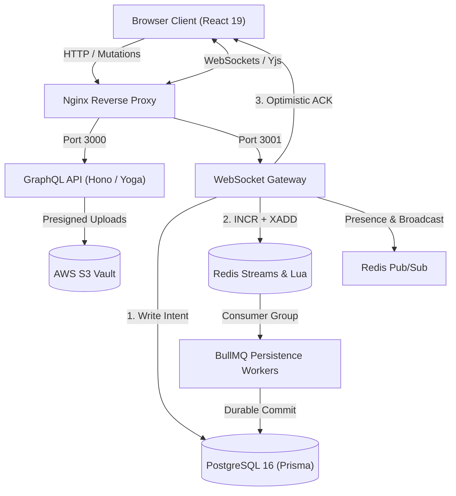

# Collabify Server

Distributed real-time collaboration engine with transactional messaging, outbox pipelines, and CRDT synchronization.

[](https://www.typescriptlang.org/)
[](https://the-guild.dev/graphql/yoga-server)
[](https://redis.io/)
[](https://www.postgresql.org/)
[](https://collabifyy.com)

## Overview

Modern engineering teams often juggle separate tools for chat, documentation, whiteboarding, and file sharing. Collabify unifies these workflows into a single multi-tenant workspace with strict real-time consistency guarantees. It pairs a PostgreSQL transactional outbox with atomic Redis Streams sequencing to deliver sub-2ms optimistic chat acknowledgements alongside durable message persistence and conflict-free collaborative editing.

<!-- TODO: add full-screen workspace demo GIF here -->

## Key Features

- **Transactional Chat Pipeline:** Outbox pattern in PostgreSQL combined with Redis Streams and BullMQ background workers for at-least-once message delivery.
- **Atomic Monotonic Sequencing:** In-memory Redis Lua script (`INCR` + `XADD`) guaranteeing gapless message ordering per channel.
- **Collaborative Notes & Canvas:** Real-time multi-user document editing and whiteboard drawing powered by Yjs CRDTs over WebSockets.
- **Multi-Tier Authorization Caching:** Scope- and resource-level Redis permission caching with 10 cascade-invalidation modules.
- **TOCTOU-Safe Storage Vault:** AWS S3 file vault with transactional byte reservations (`reservedBytes`) enforcing workspace quotas.
- **Multi-Channel Notifications:** Event-driven notification pipeline with batching, Redis presence-aware routing, and preference filters.
- **Kanban Issue Tracking:** Project-scoped task management with drag-and-drop column positioning using fractional indexing.

## Architecture

Collabify separates real-time ingestion from durable persistence. Client actions enter through an Nginx reverse proxy routing to either the GraphQL HTTP API or the WebSocket Gateway. Chat writes persist an intent record to PostgreSQL, trigger an atomic Redis Lua sequence increment, and return an optimistic acknowledgement to the client before asynchronous BullMQ workers finalize records to the relational archive.



### Key Design Decisions
- **Transactional Outbox + Redis Streams:** Chat writes record intent in PostgreSQL and stream via Redis, preventing database latency from degrading the real-time chat experience.
- **In-Memory Lua Monotonic Counter:** Sequences every message atomically on the ingest path, eliminating race conditions across concurrent writers.
- **Multi-Tier Redis Caching:** Caches workspace and project permissions in Redis with cascade invalidation, eliminating repetitive relational queries on hot authorization paths.
- **Yjs CRDT over WebSockets:** Resolves concurrent document and whiteboard edits deterministically without centralized lock contention.

## Tech Stack

| Domain | Technologies |
| :--- | :--- |
| **Backend** | TypeScript, Bun, Hono, GraphQL Yoga, WebSockets (`ws`), BullMQ |
| **Data & Cache** | PostgreSQL 16 (Prisma ORM, 55 models), Redis 7 (Streams, Pub/Sub, Lua) |
| **Storage & Infra** | AWS S3, Docker, Docker Compose, Nginx Reverse Proxy |
| **Integrations** | Clerk (Authentication), Resend / SendGrid (Email), Firebase Cloud Messaging |

## Performance & Benchmarks

Measured on an 11th Gen Intel i5-11300H (Ubuntu 24.04, Docker containers, Bun runtime). Source: [`benchmark.md`](./benchmark.md).

| Metric | Result | Methodology / Condition |
| :--- | :---: | :--- |
| **Client Optimistic ACK** | **< 2.0 ms** | p50 (1.51 ms PostgreSQL Outbox intent + 0.28 ms Redis Lua sequence) |
| **End-to-End Persistence**| **6.77 ms** | p50 total durable pipeline latency (4.22 ms min, 15.49 ms p95) |
| **Sequencing Throughput** | **1,024+ ops/sec** | 100 concurrent writers firing into a single channel; 100% gapless order |
| **Auth Cache Hit Latency**| **0.04 ms (40 $\mu$s)**| 48.5x speedup over PostgreSQL relational queries (2.00 ms p50) |
| **Duplicate Rejection**   | **100%** | 10 concurrent duplicate requests yielded exactly 1 database record |
| **CRDT Convergence**     | **100%** | 10 concurrent peers (200 operations) converged with zero divergence |

## Getting Started

### Prerequisites
- [Bun](https://bun.sh/) $\ge$ 1.3
- [Docker](https://www.docker.com/) and Docker Compose

### Local Setup
```bash
# 1. Clone repository
git clone https://github.com/official-collabify/collabify-server.git
cd collabify-server

# 2. Configure environment
cp .env.example .env

# 3. Start PostgreSQL and Redis containers
docker compose up -d

# 4. Install dependencies and run database migrations
bun install
bunx prisma migrate deploy
bun run db:seed

# 5. Start development API server
bun run dev
```

The GraphQL API playground is available at `http://localhost:3001/graphql`.

## Project Structure

```
collabify-server/
├── prisma/                     # Prisma schema (55 models), seeds, and migrations
├── src/
│   ├── app/                    # HTTP server entry points, Hono routes, GraphQL schema
│   ├── modules/                # Domain modules (chat, workspace, vault, whiteboard, auth)
│   ├── services/               # BullMQ queues, email providers, and locking services
│   └── infra/                  # Redis Streams, WebSocket gateway, AWS S3, and Lua scripts
├── scripts/                    # Schema synchronization, permission checks, and RBAC tools
├── benchmark.md                # Comprehensive empirical benchmark and reliability validation report
└── docker-compose.yml          # Local container definitions for PostgreSQL and Redis
```

## Status & Roadmap

**Current Status:** Working production prototype; deployed and accessible at [collabifyy.com](https://collabifyy.com).

- [ ] Implement AI assistant resolvers for existing `CollabifyAiConversation` database models.
- [ ] Implement `SELECT FOR UPDATE` row locking to resolve PostgreSQL `READ COMMITTED` TOCTOU storage quota races under heavy concurrent uploads.
- [ ] Add end-to-end integration test suites for BullMQ message recovery jobs.
- [ ] Automate Kubernetes (k3s) / AWS ECS production deployment pipelines.

## Links & Contact

- **Live Application:** [collabifyy.com](https://collabifyy.com)
- **Portfolio:** [itsmesarthak.site](https://www.itsmesarthak.site/)
- **GitHub:** [@chill-czar](https://github.com/chill-czar)
- **LinkedIn:** [Sarthak Chaudhari](https://www.linkedin.com/in/its-sarthak-chaudhari/)
- **Email:** [aisarthak2@gmail.com](mailto:aisarthak2@gmail.com)
